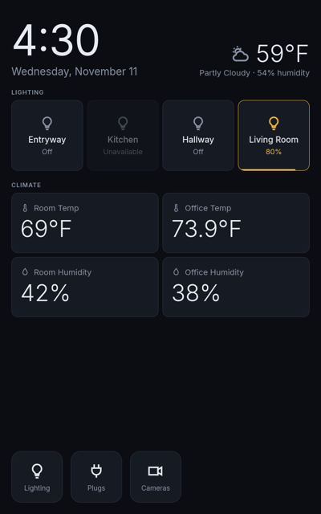

# tsv-nura: Linux Home Assistant panel on the Lenovo ThinkSmart View

This repo turns a **Lenovo ThinkSmart View (CD-18781Y)**, the 8" Teams/Zoom desk display, into a lean Home Assistant
wall panel. It runs **Nura** (the renamed postmarketOS) v26.06 with a mainline Linux kernel.

<a href="docs/native-panel-home.png"></a>

It reproduces a working reference unit exactly:
- It boots from a locked bootloader through a signed lk2nd, with no unlocking needed.
- It joins your Wi-Fi on first boot, needing no keyboard.
- A kiosk owns the screen, and **no login prompt is ever shown**. The kiosk restarts forever if it crashes.
- Idle eMMC writes are near zero: the journal is in RAM, noatime is set and unused services are masked.
- **Optional:** the front camera works (an out-of-tree S5KC505A driver plus a CAMSS fix and patched libcamera).
- **Optional:** remote metrics, syslog forwarding, remote screen view and reboot.
- **Reversible:** a bit-exact backup of the whole eMMC can be written back at any time.

> Working with an AI coding agent? It must follow [AGENTS.md](AGENTS.md).

## Choose your kiosk first

| | **Chromium** (`KIOSK_MODE=chromium`) | **Native panel** (`KIOSK_MODE=native`) |
|---|---|---|
| What you see | Your own HA dashboard (any cards, HACS, themes) | A fixed panel: clock and weather, light helpers, climate grid, Lighting page by area, Plugs page, brightness on long-press |
| Configure in | Home Assistant, as usual | `kiosk/native/config/config.toml` (entity ids, labels) |
| HA connection | Browser session: log in once (see [kiosk/chromium](kiosk/chromium/README.md)) | Long-lived token in `.env` (`HA_TOKEN`) or written by hand to `/etc/tsv-panel/ha_token` |
| Build needed | None (Alpine's `chromium` package) | Rust build in the build VM (about 1 min once deps are cached) |
| Resource use | Heavy for 2 GB RAM and an Adreno 506. Not measured on the reference unit | About 270 MB RAM used system-wide on the reference unit |
| Status | Scripts provided, **not yet run on the reference unit** | **Tested daily on the reference unit** |

Both modes run as the same service, `tsv-kiosk.service` (cage on tty1, as the locked user `kiosk`). `kiosk/setup.sh <mode>` switches between them at any time.

## Hardware facts

| | |
|---|---|
| SoC | Qualcomm APQ8053 (msm8953 family), Adreno 506 GPU (freedreno) |
| RAM / storage | 2 GB / 8 GB eMMC |
| Display | 800×1280 portrait, touch |
| Bootloader | **Must stay locked.** An unlocked TSV does not boot. It boots only AVB1-signed images, so this repo ships an AVB1-signed lk2nd 23.1 (`flash/`) |
| Rootfs location | Nura's image is written to the `userdata` partition and appears as `/dev/loop0` (p1 = /boot, p2 = /) |
| EDL (flash mode) | Power off, hold **Vol Up + Vol Down**, then connect USB-C. The screen stays black |
| Camera | One sensor, and it varies by unit: Samsung **S5KC505A** (the reference unit's, working), Samsung **S5K4E8** or OmniVision **OV5693**. See [camera/vendor/README.md](camera/vendor/README.md) to identify yours and port to it |
| Not working / disabled | Venus HW video codec (fails to probe), Bluetooth and accelerometer (blacklisted, unused) |

## What you need

- A ThinkSmart View CD-18781Y and a USB-C data cable.
- A build host:
  - A Mac (Apple Silicon is ideal; builds run in a Lima VM).
  - Or an arm64/x86_64 Debian or Ubuntu machine.
  - About 40 GB free disk, plus 8 GB for the eMMC backup.
- A Home Assistant instance reachable from the TSV's network.
- 2.4/5 GHz WPA2-PSK Wi-Fi. The image bakes in one network.

## Step by step

```bash
cp .env.example .env            # then edit: TSV_USER, Wi-Fi, HA_URL, KIOSK_MODE ...
```

1. **Build host** (once):
   ```bash
   build/00-build-host.sh
   ```
   This sets up the Lima VM (or native packages), then fetches pinned pmbootstrap and lk2nd into `.build/` and creates this repo's own pmbootstrap config and pmaports checkout. It never touches an existing pmbootstrap setup.
2. **Image:**
   ```bash
   build/20-build-image.sh
   ```
   It asks for the password of `TSV_USER`, or reads `TSV_PASSWORD_FILE`. **You choose the username and password.** The account gets sudo, and your SSH key is generated into `secrets/` and baked into the image. The image also gets your hostname, timezone and Wi-Fi.
   - Optional: `build/10-build-lk2nd.sh` rebuilds the signed lk2nd. A tested copy is already in `flash/`.
3. **EDL tooling and loader:**
   ```bash
   flash/flash.sh setup-edl
   flash/fetch-firehose.sh
   ```
   `fetch-firehose.sh` downloads and verifies the proprietary firehose loader, which is not in git ([SOURCE.md](flash/firehose/SOURCE.md)).
   This installs bkerler/edl (pinned) and its venv. On macOS it also installs libusb via Homebrew.
4. **Put the TSV in EDL mode** (see Hardware facts), then confirm the connection:
   ```bash
   flash/flash.sh detect
   ```
5. **Back up the whole eMMC. Do not skip this.**
   ```bash
   flash/flash.sh backup
   ```
   - It writes a ~7.3 GB `backup/emmc-full.bin` plus its SHA256.
   - This is your only way back to the original Android, and it contains device-unique calibration (persist, modemst, fsg).
   - Store it off the build host too.
6. **Flash:**
   ```bash
   flash/flash.sh flash
   ```
   This writes lk2nd to `boot` and Nura to `userdata`, then reboots. The first boot takes about a minute.
7. **Find the TSV's IP** in your router's DHCP leases. A DHCP reservation is recommended. Put it in `.env` as `TSV_HOST`.
   - Then `ssh -i secrets/tsv_ed25519 <TSV_USER>@<TSV_HOST>` should work.
   - USB networking also works: `172.16.42.1`, while the USB cable is attached.
8. **First boot fixes:**
   ```bash
   device/first-boot.sh
   ```
   This grows the root fs to fill the partition, masks `qbootctl` (it fails on this non-A/B device) and prints health.
9. **Kiosk:**
   - Native:
     ```bash
     cp kiosk/native/config/config.example.toml kiosk/native/config/config.toml   # edit
     kiosk/native/scripts/build.sh
     kiosk/setup.sh native
     ```
   - Chromium:
     ```bash
     kiosk/setup.sh chromium
     kiosk/chromium/login-remote.sh   # one-time HA login, see kiosk/chromium/README.md
     ```
10. **Slim:**
    ```bash
    device/slim.sh
    ```
    This masks unused services, blacklists unused drivers, puts the journal in RAM and sets noatime. It is recommended for a 24/7 panel.
11. **Optional extras:**
    - `camera/install.sh` enables the front camera if your unit has the **S5KC505A** ([camera/README.md](camera/README.md)).
      - Units with an S5K4E8 or OV5693 need a port first; see [camera/vendor/README.md](camera/vendor/README.md).
      - For a different kernel, build matching artefacts with `build/30-build-camera-kernel.sh` and `build/31-build-libcamera.sh`, then run `camera/install.sh out/camera`.
    - `extras/remote-control/setup-remote.sh` sets up node_exporter, syslog forwarding and the remote screen/camera/reboot user.
    - `device/add-user.sh` adds more logins. Each person picks their own credentials.

## The build chain (everything is built from this repo)

All scripts resolve paths from the repo root, and nothing is hard-coded to a user or directory.

| Path | Holds | Notes |
|---|---|---|
| `.env` | Settings | Read by every script |
| `.build/` | Fetched tools and sources (pmbootstrap, lk2nd, venv, kernel tarball cache) | Git-ignored |
| `out/` | Build results | Git-ignored |
| pmbootstrap work dir | Chroots, packages, the repo's own pmaports clone | On Linux: `.build/work`. On macOS: inside the VM's own disk, because chroots need a native Linux filesystem. Override with `PMB_WORK` |

| Step | Script | Pinned inputs | Output | Verified |
|---|---|---|---|---|
| Host | `build/00-build-host.sh` | Debian 13 VM, pmbootstrap `e0dfe2cd` (3.12.1-7), lk2nd `e9c8b217` (23.1) | `.build/` | Yes |
| lk2nd | `build/10-build-lk2nd.sh` | lk2nd 23.1 plus the AOSP test key (AVB1) | `out/lk2nd-signed-23.1.img` | Yes: byte-identical to `flash/` |
| Nura image | `build/20-build-image.sh` | pmaports `v26.06`, device `qcom-msm8953`, UI console | `out/nura-qcom-msm8953.img` | Yes: account, key, Wi-Fi, timezone and kernel 7.0.9 checked inside the image |
| Native panel | `kiosk/native/scripts/build.sh` | Alpine v26.06 Rust (1.96.1) in pmbootstrap's native chroot, `Cargo.lock` (`--locked`) | `kiosk/native/target/tsv-panel` | Yes: runs on the reference unit |
| Camera kernel | `build/30-build-camera-kernel.sh` | msm8953-mainline `v7.0.9-r0` tarball (sha512 pinned by pmaports), pmaports kernel config, `camera/upstream/kernel/*.patch`, Alpine clang (LLVM=1) | `out/camera/*.ko`, DTB | Yes: reproducible, DTB byte-identical, modules streamed on the reference unit |
| libcamera | `build/31-build-libcamera.sh` | pmaports `temp/libcamera` 0.7.1 plus `camera/libcamera-pmaports/` | `out/camera/apks/` | Builds. The prebuilt APKs in `camera/prebuilt` are the ones installed on the reference unit |

Rough timings on an Apple Silicon Mac, after the first downloads: panel about 1 min, image about 1–2 min, kernel modules a few minutes, libcamera about 2 min.

## Managing the Home Assistant connection by hand

Everything in `.env` is optional at install time. You can change it on the device later.

| Mode | File on the TSV | Apply with |
|---|---|---|
| native | `/etc/tsv-panel/config.toml`: `url = "https://ha.example:8123"` | `sudo systemctl restart tsv-kiosk` |
| native | `/etc/tsv-panel/ha_token`: one line, the long-lived token, `root:kiosk` 0640 | same |
| chromium | `/etc/tsv-kiosk/kiosk.env`: `HA_URL=…`, `HA_DASHBOARD_PATH=/lovelace/0` | same |

Re-running `kiosk/setup.sh` with an updated `.env` does the same from your computer. With `HA_TOKEN` empty, it asks for the token, or you can press Enter to keep the token already on the device.

## Day-to-day

- **Logs:** `ssh … journalctl -u tsv-kiosk -f`. After `slim.sh`, logs live in RAM only and are lost at reboot unless forwarded.
- **Screenshot:** `kiosk/native/scripts/shot.sh out.png` works for both modes.
- **Updates:** `sudo apk upgrade` on the TSV.
  - **Caution:** a kernel upgrade replaces the camera DTB and modules, and a libcamera upgrade drops the camera sensor helper. Re-run `camera/install.sh` or rebuild afterwards.
  - Without the camera extras, upgrades are safe.
- **Getting a shell on the display** is deliberately impossible: there is no getty and no VT switching. Use SSH, or USB networking at 172.16.42.1.

## What comes from the stock firmware

The only vendor files the flashing needs are `flash/firehose/prog_emmc_firehose_8953_ddr.mbn` (the EDL loader) and
`rawprogram0.xml` (the stock partition layout, kept for reference). They are proprietary, so they are **not in git**:
`flash/fetch-firehose.sh` downloads and verifies them. Their source is in [flash/firehose/SOURCE.md](flash/firehose/SOURCE.md). Everything else written to the device is built by this repo: the signed lk2nd goes to `boot` and the Nura image to `userdata`. The full stock firmware package (1.3 GB) is **not** needed to flash. Two consequences:

1. **Rollback uses your own backup, not stock firmware.** `flash/flash.sh restore` writes back the eMMC dump taken before flashing, which is why `flash.sh flash` refuses to run without it.
   - If a backup was never taken, the only way back to Android is Lenovo's stock firmware package, flashed with Qualcomm's QFIL or `edl`. That's outside this repo's scripts; the download link is in `flash/firehose/SOURCE.md`.
2. **Wi-Fi and the audio DSP depend on the device's own stock partitions.** Nura does not ship the Qualcomm firmware for the Wi-Fi, ADSP and modem cores. At boot `msm-firmware-loader` loads it from the TSV's untouched `modem` and `vendor` partitions, mounted under `/run/msm-firmware-loader/`.
   - Flashing writes only `boot` and `userdata`, so these stay intact.
   - A unit whose other partitions were wiped or overwritten needs them restored first, from a backup or the stock package, or Wi-Fi won't come up.

The vendor partition also holds the Android camera stack. `camera/vendor/fetch.sh` copies the files for all three
camera variants from your own unit, as reference material for porting; nothing loads them.

### Proprietary files are never pushed

`.gitignore` excludes these, so they can sit in a local checkout but never reach GitHub:
- the firehose loader and `rawprogram0.xml`
- `camera/vendor/lib/`, `camera/vendor/etc/`
- the stock DTB/DTS
- backups, images, `.env` and `secrets/`

Each one has a fetch script and a sha256 in the repo. Everything else that's committed is original work, upstream open source (lk2nd, patches against GPL kernel code, LGPL libcamera packaging) or facts recorded about the hardware.

## Rollback to the original system

1. Put the TSV in EDL mode.
2. Run `flash/flash.sh restore`. It writes `backup/emmc-full.bin` back byte for byte (GPT and every partition), then reboots.

## Repo layout

```
.env.example        all settings (copy to .env)
scripts/lib.sh      shared helpers: .env loading, ssh/sudo to the TSV, build VM wrapper
build/              00 build host / 10 lk2nd (optional) / 20 Nura image / 30+31 camera kernel modules + libcamera
scripts/build-env.sh  build-side helpers (pmb wrapper with the repo's own config, work dir and pmaports)
flash/              flash.sh (EDL), fetch-firehose.sh, signed lk2nd, SHA256SUMS (firehose loader fetched, not in git)
device/             first-boot.sh, add-user.sh, slim.sh (+ remote/ scripts and rootfs/ config files)
kiosk/              setup.sh (installs either mode), common/ (logind: no VTs), chromium/, native/ (Rust + Slint)
camera/vendor/      porting guide, dump tool, fetch scripts for the 3 sensor variants (vendor files fetched, not in git)
camera/             S5KC505A driver, CAMSS patch, DTS, libcamera packaging, prebuilt modules/DTB/APKs, upstream series
extras/             remote-control (node_exporter, rsyslog, forced-command SSH user)
```

## Known issues / notes

- **Chromium mode is untested** on the reference unit. It may need flag tuning for GPU, memory or touch. Report back.
- The firehose loader's origin is documented in [flash/firehose/SOURCE.md](flash/firehose/SOURCE.md).
- The reference image was built from pmaports `v26.06` with pmbootstrap 3.12.1-7. A rebuild today pulls newer v26.06 packages, so the kernel may be newer than 7.0.9, which matters for the camera.
- After `pmbootstrap install`, the root fs is only as big as its contents until `device/first-boot.sh` runs `resize2fs`.
- Alpine has no `bash` by default. Give users `/bin/ash`: a missing login shell makes logins fail with a "wrong password".
- `flash/firehose/prog_emmc_firehose_8953_ddr.mbn` is Qualcomm/Lenovo's signed EDL loader. It is **not** the one inside the stock firmware zip. `flash/fetch-firehose.sh` fetches the right one; see `flash/firehose/SOURCE.md`.
