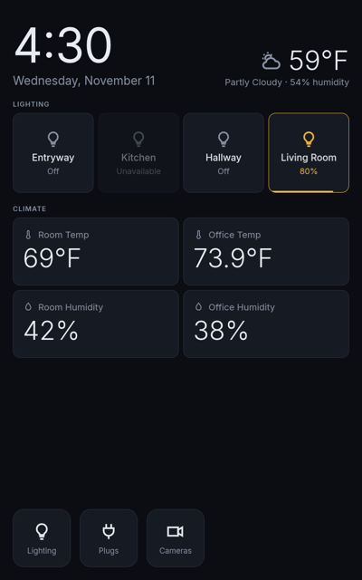

# tsv-panel (native kiosk)

A native Home Assistant wall panel for the ThinkSmart View, written in Rust and Slint. There's no browser.
It talks to HA's WebSocket API with a long-lived access token.



## Stack

| Layer | Pieces |
|---|---|
| UI | Slint 1.x (`ui/app.slint`, 800×1280 portrait) with the femtovg renderer on OpenGL ES (Mesa freedreno, Adreno 506), winit Wayland backend |
| Compositor | cage (single-app Wayland kiosk) on tty1, as the locked user `kiosk` (`tsv-kiosk.service`) |
| Backend | tokio, tokio-tungstenite + rustls (webpki roots), serde |
| Source | `src/main.rs` (UI wiring, idle return, control socket), `src/ha.rs` (WebSocket client, area/device/entity registries), `src/view.rs` (state → tiles, area grouping, layout packing), `src/config.rs` |

## Pages

- **Home:**
  - Clock and weather.
  - A lighting row of your configured lights or helpers.
  - A climate grid.
  - Buttons for Lighting, Plugs and Cameras (a placeholder).
- **Lighting:** every `light.*` in HA, grouped by HA area.
  - Light-group helpers are full-width tiles, with their bulbs below as compact tiles, four per row, using `[lighting.short_names]`.
  - An area with a single light shows it as a main tile.
- **Plugs:** the configured switches, grouped by area, with live wattage from `sensor.<plug>_power`. Hold 2 s to toggle.
- **Interactions:**
  - Tap a light to toggle it. Hold 1 s for the brightness overlay, which sends at most every 400 ms while dragging.
  - Sub-pages return Home after `idle_return_seconds`.
- **Safety:** only `light.*` and the configured plugs can be switched; anything else is rejected.

## Build, configure, install

```bash
cp config/config.example.toml config/config.toml   # your entity ids
scripts/build.sh            # Lima VM -> pmbootstrap native chroot (same Alpine/musl as the device) -> target/tsv-panel
scripts/build.sh test       # unit tests
../setup.sh native          # install + HA URL/token + service (from the repo root: kiosk/setup.sh native)
```

### HA connection

| Setting | How to set it |
|---|---|
| URL | `HA_URL` in `.env`. `setup.sh` writes it into `/etc/tsv-panel/config.toml` |
| Token | `HA_TOKEN` in `.env`, or typed at the `setup.sh` prompt, or written by hand on the TSV (below) |

To write the token by hand on the TSV:
```sh
printf '%s' 'YOUR_TOKEN' | sudo tee /etc/tsv-panel/ha_token >/dev/null
sudo chown root:kiosk /etc/tsv-panel/ha_token && sudo chmod 0640 /etc/tsv-panel/ha_token
sudo systemctl restart tsv-kiosk
```

## Dev helpers

```bash
scripts/shot.sh out.png          # screenshot of the display
scripts/ctl.sh page 1            # switch page (0 home, 1 lighting, 2 plugs, 3 cameras)
scripts/ctl.sh dim light.x       # open the brightness overlay; `close` to dismiss
```

Logs: `journalctl -u tsv-kiosk -f` on the TSV. App lines appear as `cage[...]`.
